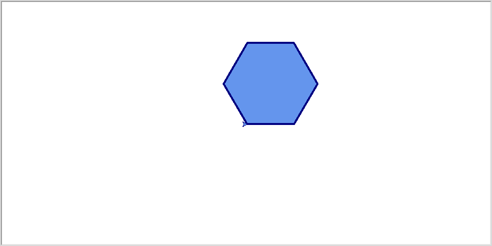
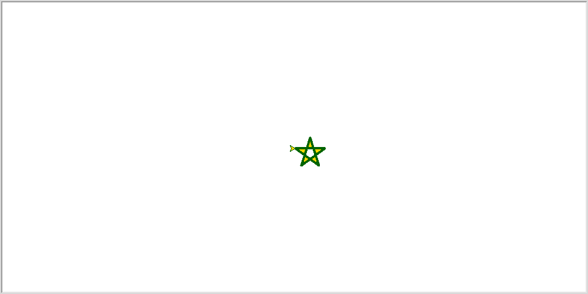

# PeyintTR

A small command-based drawing application I created in 2018 while learning Python.

This repository preserves the original learning project and is shared for educational and historical purposes. It is no longer actively maintained.

## Running

Install the required Python package and run `main.py` (or `basla.bat`). The program expects a personal music file named `muzik.wav` in the same folder. Add your own `.wav` file before starting the application.

## Release

The Windows executable will be published in the repository's Releases section when available.

<!-- project-screenshot-gallery:start -->
## Screenshots

  
  

<!-- project-screenshot-gallery:end -->
